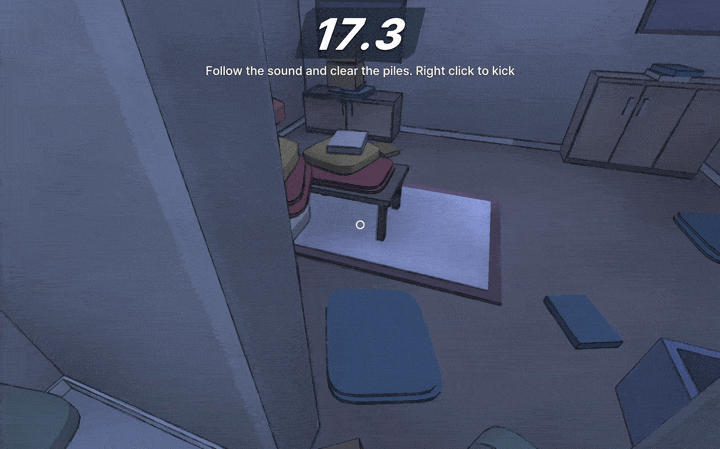

# Missed Call

> Submitted to [20 Second Game Jam 2026](https://itch.io/jam/20-second-game-jam-2026) on itch.io.

**Your phone is ringing somewhere. Find it and pick up before it stops.**

A first-person game where you have 20 seconds to track down a ringing phone by sound alone, dig it out from under the clutter, and answer it.

## How it plays

- **Sound is your only clue.** The ringtone is 3D audio. It gets muffled the more stuff is piled on top of the phone, muffled again through walls, and when the phone is in another room you hear it coming from the doorway that leads there.
- **No two rounds are the same.** Every round builds a new small house (2–4 rooms: bedroom, living room, kitchen, bathroom, dressing room), hides the phone under a different pile, and picks a different caller with their own ringtone.
- **Make a mess.** Grab cushions, blankets, books and boxes, then swing and release to fling them. Kick piles, slam into them at full speed, tip over laundry baskets, open drawers.
- **The clock closes in.** Under 10 seconds the screen starts to tighten; in the last 5 the timer turns red and your heartbeat kicks in.

### Twists

Half of the rounds come with one twist:

| Twist | What happens |
|---|---|
| Vibrate only | No ringtone, just a low buzz and shaking piles |
| Low battery | The phone dies partway through the round |
| Something else is ringing | An alarm clock buried in another pile tries to fool you |
| Noisy house | A ceiling fan drones in another room |
| Blackout | The house goes dark; only the phone's screen glows |
| Robot vacuum on the loose | The phone rides a robot vacuum from room to room |

A vibrating phone with little on top of it also crawls across the surface and can drop off the edge of a table, right when you've almost dug it out.

### Callers and titles

Whoever is calling reacts to whether you picked up: Mom, a delivery driver, a job interview, the fried chicken place, an unknown number, and a couple of rare callers. Pull off something special and the result screen gives you a title such as *Speedrunner*, *Buzzer Beater* or *Sniper*. Your best time, calls answered and missed, callers met and titles earned are kept between rounds, and only for show: every round starts from scratch.

## Controls

| Input | Action |
|---|---|
| WASD / Arrow keys | Walk |
| Mouse | Look around |
| Hold left click | Grab. Release to throw; swing the mouse while releasing to fling it |
| Left click | Pick up the phone, open drawers |
| Right click | Kick |
| Drag the slider | Answer the call |
| Esc | Pause |
| R | New round |

Desktop browser with keyboard and mouse only. **Headphones make the direction much easier to hear.**
